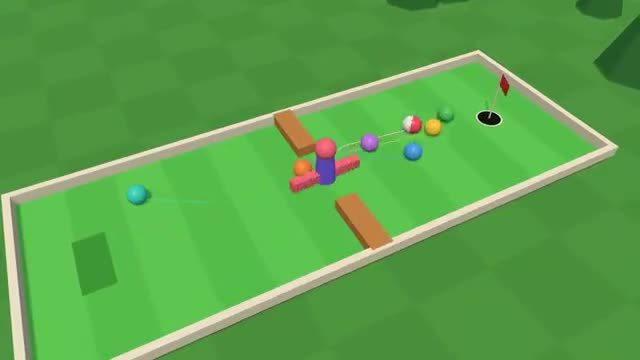

# Mini Golf

Everyone putts at the same time. A multiplayer starter game from [Multiplayer Agent](https://multiplayeragent.com): 3D, versus, 1–8 players, with bots that fill empty seats.

## How it plays

Drag back and let go to putt. Everyone plays the same hole at once and sees the other balls roll. Fewest strokes over six holes wins.

**Controls:** Drag back and let go, with a mouse or a finger.

## Make it yours in the Game Builder

Open the [Game Builder](https://multiplayeragent.com), choose **Start from a starter game** and pick Mini Golf. It opens as version 1 in your studio, ready to play and publish. Then ask for changes, for example:

- Add a windmill with real blades in front of the cup
- Add a hole where the floor tilts
- Make it a space course with low gravity

## Run it yourself

1. Get a free publishable key (`pk_…`) at [multiplayeragent.com](https://multiplayeragent.com).
2. In `index.html`, put it in place of `pk_REPLACE_ME` in the `MP_CONNECT` block.
3. Serve the folder (for example `npx serve`) and open it. The 3D engine loads as a module, which browsers block from a file on disk.

Without a key it still runs, offline against bots.

## How it is built

- One `index.html` plus three.js in `libs/`. The comment at the top of the script maps the code and explains the multiplayer.
- The holes are data in `CONFIG.holes`: an outline, a tee, a cup, and blocks, bumpers, windmills and slopes. Bots plan their putts by simulating them, so they can play any hole you add.
- **Leaderboard:** The fewest strokes for a full round of the course.
- **Host-run rounds:** The host's browser runs the hole timer and the scorecard; if it leaves, the next player takes over.
- **Bots:** Bots putt alongside you until enough people join.
- **Live sync:** Every ball rolls for everyone at once.
- `?attract` runs it offline with bots only. The preview video is recorded from it.

## License

MIT. three.js in `libs/` is MIT too (Copyright 2010-2024 three.js authors).
